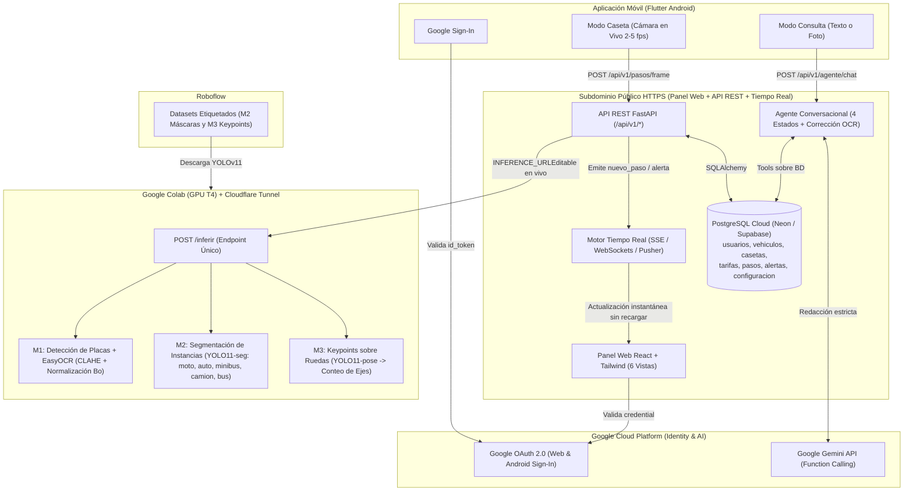
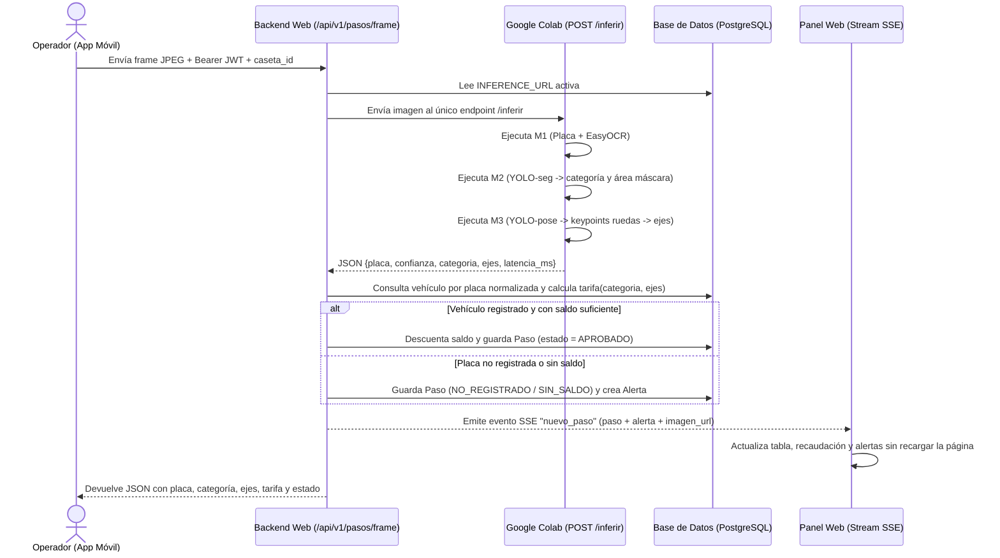

# Diagramas de Arquitectura y Flujo del Sistema Inteligente de Control de Peaje (IAM-811)

## 1. Arquitectura General Cloud-Native (100% Nube sin Recursos Locales)

---

## 2. Diagrama de Secuencia: Registro de Vehículo en Caseta y Tiempo Real

